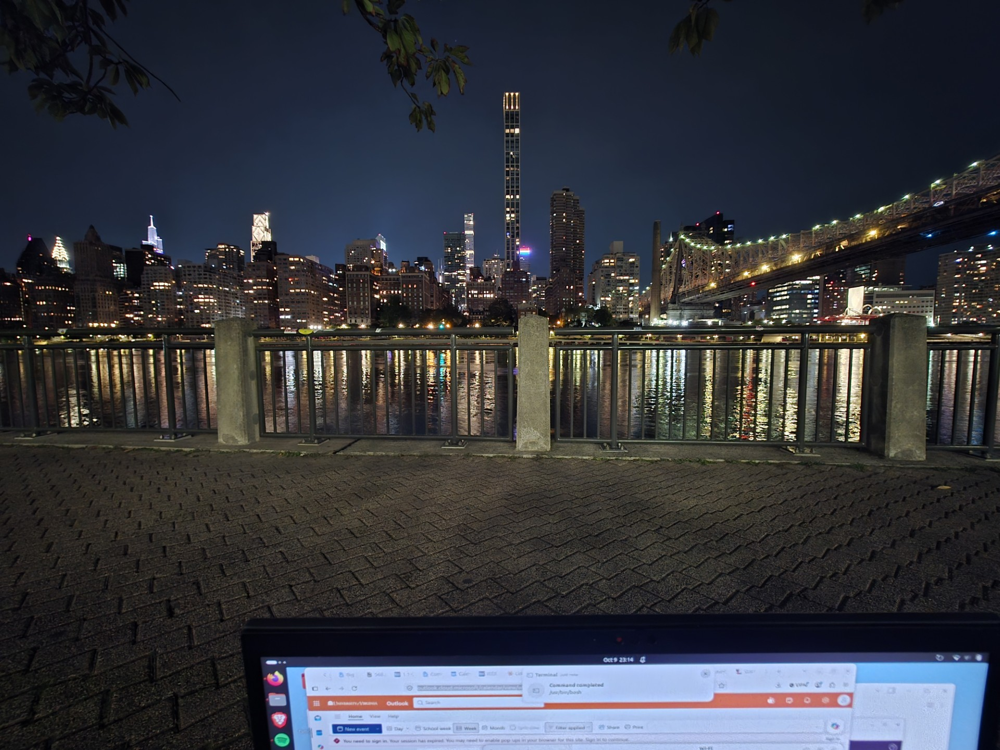

Hello to those who are reading this. It has been a while since I wrote anything
regarding either my personal or professional life. I thought that since I'm 
beginning a new chapter of my life, this would be a good time to write
something. Enjoy this picture of Manhattan, as I'm sitting here writing this.

The reason I started writing anything in the first place was because I was in a
mentally challenging place, and doing it provided me with some comfort. It has
been a long time since then, and I have for the most part healed and moved on.
Both technical, and personal blogs are a big relief for myself as I have found, it's
perhaps because it frees me from bottling up things that I need to speak into
the void about.
As of now I'm very happy with where I am, and as such I won't be writing as much
from now on, so I thought I might include personal updates in this one instead
of using my Notion site. That is unless I find myself seeking that comfort again :)

# Some thanks first
I never got around to making a post on Linkedin bragging about where I'm going
for school, so I would like to thank mainly three people that tremendously
    impacted my life.
1. **Prof. Jon Balkind at UCSB.** Thank you for being an amazing advisor in some of
   my undergrad and MS program. You were extremely busy yet you still always
   found time to answer my dumb questions, I became a moderately-decent-ish
   architect thanks to you, better than I thought I would've been able to. You
   fostered a really great environment that allowed me to grow socially as well,
   and one skill I really learned from you was how to be more thorough in my
   thinking, and how I shouldn't be afraid to talk to other people, because they
   too might not understand what's going on.
2. **Dr. Sudhanva Gurumurthi at AMD.** Thank you for being an amazing
   advisor/manager for my 9 months at AMD. I learned so much from you and the
   RAS group at AMD. You made me realize I too had potential of being
   someone that can do great things. You believed in me enough to let me pursue
   my ideas for my project, and went to bat for me
   in PhD applications, and allowed me to go to ISCA 2025. I couldn't have
   expected such support from anyone, let alone someone who was already paying
   me, so really I am beyond grateful.
3. **Prof. Forrest Brewer at UCSB.** You were never really my main or secondary
   advisor, but you did have tremendous impact on me. You made me realize my
   passion for architecture + VLSI through a somewhat fun way of describing that
   "these guys don't know what they're talking about". I aspire to learn enough
   to one day talk to you about all the things that I always had to try to keep
   up with when asking you anything. I chose to do my PhD in VLSI in large
   thanks to/(because) of you. Your retirement is certainly a big loss to the
   ECE department at UCSB.

# Part 1: PhD, so it begins...
So actually, I don't think I've written it anywhere since it happened, but in
any case, I have begun my PhD in Computer Engineering at The University of
Virginia in the RLPVLSI group, and my advisor is Prof. Ben Calhoun. I wanted to
mention that I didn't know about Ben when I started applying and even
interviewing until he reached out to me. Funnily enough, as it happens my top
choices were guys who did ECE at MIT, and I did not get into any of those
groups, but as it happens Ben also did ECE at MIT, his advisor was Chandrakasan,
which is arguably one of the most influential semiconductor researchers of all
time. I feel that sometimes life is kinda funny like that, and I feel tremendous
pressure in living up to the "heritage". Ben is extremely smart and has done
very foundational work that allows CMOS to be where it is today, and I want to
try my best to learn the most I can from such a person.

In our group, the research theme is generally speaking "How to design better
chips for ultra-low-power domains such as batteryless/energy harvesting systems,
and enable interesting applications, such as body monitoring, in-textile
computing, extreme distributed edge ML applications". As a person, I'm
interested in solutions that are general and long-term, and I think designing
chips that work "for free" is a nice way of scratching my itch for finding such
solutions.

## Why PhD at all?
Is something that I've been asked a few times, having turned down some
eyewatering employment offers. To be honest, you'll see below, but the first reason is that I did make a lot of
money for some period, and still I was extremely unhappy. To some degree the
famous saying "money doesn't buy happiness" is still somewhat "only rich people
say that" to me, I get some aspects of it. I recently had a nice talk with my
friend at NVIDIA, who makes about 7 times the money I will be paid in the next
4-5 years (difference of about >$1M by the time I'm out). During this talk he
said he was jealous that I was taking a risk and doing something with my life,
and while I'm inclined to agree with him as he was paying for that dinner, I
actually think it's an interesting question. 

I think that it comes down to lying
on your deathbed and being able to say that you took a risk that might not pay
off, but you created something that was wonderful that pushed forward humans, or
at the very least you took a risk and accepted a simple life in pursuit of
something you thought to have had a chance of leading somewhere. You might call
me delusional, and to be fair yeah I probably am, but I'd like to think that I
might just be smart enough to push the frontier forward, and I'm going to take a
stab at it. *To be fair* industry researchers also pushes humanity forward
sometimes at greater pace, but to get in there you'd need a PhD anyways, so.

And also, I'm not going to pretend I'm living in poverty, they pay me enough to
live a simple and single life, and I'm not someone who demands a luxurious
lifestyle, and i get to do what I want sometimes and basically go to school for
free, so honestly it's a sweet deal. Also I like teaching and one day I plan to
come back and become a professor, so I need a PhD.

## So why UVA? Why ultra-low-power VLSI?
UVA because this is the only school I got into where they actually do tapeouts,
not so many enable such opportunity anymore. I want to do tapeouts, because I
feel that before I have actually done one, I might fully know what I'm talking
about when I read/write chips papers. Now, I understand this claim might not sit
well with many people who would think tapeouts don't get you anywhere and just
higher level work is enough. Personally, I don't believe that. Furthermore, in
industry, although you get to participate in tapeouts, I don' think that really
counts, becuase as a person with an MS degree, I'll just be doing verification,
which doesn't quite scratch that itch for me.

Also, I think, or at least I have an intuition that armed with architecture,
learning and working VLSI will enable me to design things that will push the
frontier, because as I see it, the abstraction levels are nearing their limits,
and for example something like gem5 allows for things that architects think are
important, but not things that can be enabled given certain VLSI considerations,
some example are logic families, and power expectation like batteryless, low
power systems. Someone I looked up to now at Google asked me if this could be
really true. IDK, but instead of going to AI like basically all other students, 
I thought it'd be more worthwhile, or at least more interesting, to work on a
problem that I believe is so hard - improving upon extremely mature CMOS design
techniques and CPUs and GPUs that have seen trillions of dollars of investments. We'll see,
or we won't, I suppose. This is a crazy idea, but I do believe that by combining
worlds, there are new advancements to be made. I suppose one goal would be to
apply tricks in the low power domain to increase efficiency of high performance
hardware, call me crazy, but I have some ideas, and I guess you'll have to wait
and see if I can't get them published ;)

### What is UVA like?
To be honest, I love it. Coming from California, where the weather is always
perfect, I actually think it's not too bad in Virginia (tbf, haven't survived
one summer here yet, we'll see how it goes next year). The air is pretty crispy,
in Fall the leaves turn red and it is so beautiful. Charlottesville is a really
nice place in a town that's small but bigger than Santa Barbara. For anything
requiring city activities, Richmond is an hour away and DC is about 2 hours
away, and DC is a really nice place for a weekend visit. One of the criterias I
had set is that I needed to be able to get to school and around without needing
a car, Charlottesville fulfills that. I do have a car, but I don't have to use
it if I really didn't want to, catching the free bus is decent.

The campus is probably the most beautiful public school campus I've ever been
to. Designed by Thomas Jefferson himself, the architecture is beautiful with all
red brick buildings. I really feel the spirit of academia while I'm here.
Writing this, I'm in NYC now, and as fun as NYC is, I don't think its quiet and
quaint enough to be suitable for a research environment. I really can enjoy a
lot of quiet time walking around campus and thinking about random things. 

The setup for food is much better than Santa Barbara I would say. There are no
good ramen restaurants, but actually, we can take a nice 20 minute walk to "The
Corner" where there are really good restaurants for lunch, a killer bagel place,
and a place with really tasty pour overs. Inside of Charlottesville, Japanese
food is not the best, but Chinese, American and some misc things are quite nice.
If I wanted to go to an Asian market, I would have to drive like an hour to
Richmond, but as it turns out I have friends who would be willing to carpool to
Richmond and grab lunch, so its a nice weekend activity. Oh, and if you're into boba and
mochi donuts, I have to say I'm impressed by the one on the corner.

Paycheck wise, they pay me enough to save about 1k a month (tbf I'm into eating out and I tend
to not think about cost too much if I'm spending time with people I like), and I
think it's a decent setup compared to some other places. I can't complain.

# Part 2: Personal growth, what's next?
Okay so here I will mention some personal aspects.
### Being myself again
So if you read my really long personal blog uploads, you'll find out why I had a
rough time the past 2 years. I won't mention it here, but the upshot is that I
was very unhappy with my life, I had basically reached the goals I set for
myself before I started undergrad, that being making a lot of money. I felt
that I was living not for myself, but maybe for people that I wanted to impress,
and, I struggled with relationships.
As I pulled myself out of that hole, I realized that there wasn't really a good
reason I had to go to such lengths to make people like me, because if they didn't find
who I am enticing enough, then I suppose I am not a good fit for them. I think
that generally speaking, I'm not a super "regular" person, I'm interested in
things that people don't care about, I have certain ideologies and
philosophies that people find strange (don't worry I don't have crazy thoughts
about how the war should be going etc. mostly here I mean things like how it
might be good that things like electronic devices and social media should be
prohibited for children use, and how people should come to realize that in
actuality young people suffer from induced consumerism through corporate
hypermarketing and that leads to considerable waste and pointless excess), 
and throughout my life I have felt a little out of place. 
I have friends I made during these earlier years, but over time
I feel that even though they do love me and I them, we are fundamentally not the
same type of people.

However, I got lucky and started finding people that are more like me. Then I
understood they are also just living their lives happily, without my worry of having
to fit in, and I decided that I didn't need to try to fit in. For a time, I
found it lonely, but I started gaining confidence in myself after a while, and I
also attracted people that really liked me for the qualities that are inherent
to myself, not those I tried adopting/fabricating to be "within the crowd". I
have come to accept that I am indeed strange, and (brutally) boring, but that's
just how I am, and if that means I can't get most people to like me, I think I'm
alright with that.

### Maintaining & fostering relationships
I've never been good at relationships. I believe that it is an artifact of how I
was raised, basically I feel like sometimes the way I am is too robotic and too
calculative, and perhaps people I've known would describe it as unsympathetic.
Over time, as I started experience relationships, both romantic and platonic, I
learned that I really do feel very invested in a person, and losing people or
doing them wrong provokes turmoil within me. I think I was unsympathetic because
I was afraid of getting involved and in a way exposing myself to the
hypothetical of getting heartbroken. I did suffer bad ending to relationships,
but throughout I've learned that I had two weaknesses mainly, ironically they
are contradictory. I get really invested in people, and when something doesn't
live up to what I had imagined, I get really dissapointed and started to treat
people in a robotic way. I think the learning I've had is that it is truly
impossible to control people, because people are not machines and everyone has a
different way of exhibiting emotions. I cannot solve people, but I've learned
that doesn't mean I should be afraid to be hurt, because otherwise it's not
gonna be real. Also, as robotic as I was, I would expect a sequence of outcomes
over a period of time, but I've since grown out of that, because human
relationships are something to be explored and nurtured, not modeled with a
idealized solver.

Over the past some time, I've really tried to bring myself to talk to new
people and form relationships, but don't be dissapointed when things don't turn out as I had wanted
them to be, because although this means most times it just means they don't seem
to be super interested in you romantically nor platonically, just one out of a
few times, it works out, and that's really all one needs. I've made friends and
formed relationships since then that
I hope are going to last a long time, and really I've realized those are
the relationships that matter. It's also kind of like dual-selection like PhD
apps, if it works out, you'll know that it's not just that you like them, they
also like you, and it will be a lot better than one-sided effort. 
I will put a lot of effort into maintaining relationships that
are important to me, and although in quantity there aren't many, in volume they
are enough to fulfill me.

## Concluding thoughts
If you know me personally, well... this is awkward. I hope you learned something
about me and hopefully I've been able to keep our relationship good, I've been
really trying to be better. If you're someone from whom I derived some of these
lessons from, I'm sorry, I was immature and stupid, hopefully at some point I could make
it up to you.

Thank you, stranger, for reading this if you did. I just felt some motivation to
write something up, as I'm sitting in NYC with nice weather and no motivation to
run Cadence simulations (man, I hate virtuoso, shout out Hspice). I think that
it will be quite a long time until I feel a desire and compulsion to write
another one of these posts that have personal components. Over time, I will
update with some technical blogs of papers that do get accepted to places I
submit to. Or screw it, if I have a good idea that I think would be hard to
convince my advisor of, you'll get it for free.  If you cared for what I had to say regarding personal aspects, I
suppose you'll be in the dark for a while, but I sincerely hope that you gained
some value out of reading this, be it insight or laughing at me, I'll take it as
long as you're happy, I hope you are :)
